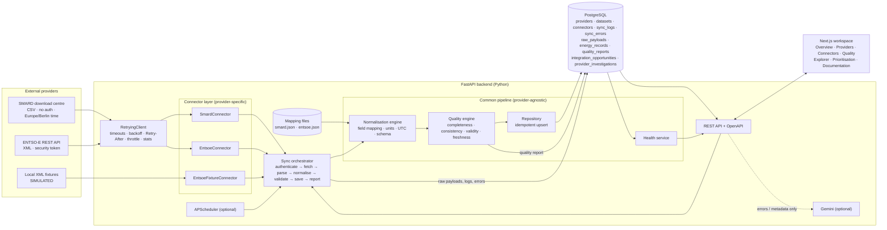

# GridLink architecture

## System overview

## The connector contract

Every connector implements the same interface (`app/connectors/base.py`):

| Method | Responsibility | Implemented by |
|---|---|---|
| `authenticate()` | Decide whether a call can be made (token present, etc.) | each connector |
| `fetch_data(start, end)` | Return raw `FetchedPayload`s (bytes + request metadata) | each connector |
| `parse_response(payload)` | Turn bytes into `SourceRecord`s in the **provider's own vocabulary** | each connector |
| `normalise_data(records)` | Map to the standard schema using the provider mapping file | common (`normalisation/engine.py`) |
| `validate_data(records)` | Record + batch quality checks | common (`quality/engine.py`) |
| `save_records(records)` | Idempotent upsert keyed by `(provider_id, source_record_id)` | common (`services/repository.py`) |
| `get_health()` | Health from stored sync logs, quality reports and records | common (`services/health.py`) |

Provider-specific knowledge lives in exactly two places: the connector class and its mapping file. The
orchestrator (`services/sync.py`) never branches on provider.

### Adding a third provider

1. Create `app/connectors/<provider>.py` with a class decorated by `@register` that implements
   `authenticate`, `fetch_data`, `parse_response` (and optionally `expected_series`, `series_category`).
2. Create `app/connectors/mappings/<provider>.json` mapping each provider series to
   `dataset_key`, `metric_type`, `energy_source`, the **published** `unit` and `frequency`.
3. Add the provider and a connector row (UI, API or `app/seed.py`). Datasets are created from the mapping on first sync.
4. Add parser tests with recorded fixtures, including failure fixtures.

No change is needed in normalisation, validation, persistence, health, the API or the UI.

## Standard energy record

| Field | Meaning |
|---|---|
| `timestamp_utc` | Interval **start**, timezone-aware UTC |
| `interval_minutes` | Interval length (15, 60, 1440) |
| `country_code` / `bidding_zone` | ISO 3166-1 alpha-2 (or `EU`) / e.g. `DE-LU` |
| `energy_source` / `metric_type` | Controlled vocabularies (`solar`, `wind_onshore` … / `generation`, `consumption`, `residual_load`, `day_ahead_price`) |
| `value`, `unit` | Canonical: **average MW** for power metrics, **EUR/MWh** for prices. `null` = provider published no value |
| `original_value`, `original_unit`, `transformation` | Exactly what the provider sent and what GridLink did to it |
| `provider_id`, `dataset_id`, `connector_id`, `raw_payload_id`, `source_record_id` | Provenance down to the raw bytes |
| `data_origin` | `real` or `simulated` |
| `ingestion_timestamp` | When it was (last) written |

### Normalisation decisions

* **Energy vs power.** SMARD publishes MWh per quarter hour; ENTSO-E publishes MW. These are different
  quantities. GridLink converts SMARD to average MW (`MWh ÷ 0.25 h`) and records the transformation on every row.
* **Time.** SMARD timestamps are Europe/Berlin local time. The DST fall-back hour appears twice; GridLink resolves it
  from row order (`ambiguous="infer"`). Naive timestamps without a declared source timezone are rejected.
* **Missing ≠ zero.** `-` is stored as `null` and counts against completeness; `0.00` stays zero.
* **No implicit merging.** "Hydro pumped storage" appears in both SMARD's generation and consumption files and in
  ENTSO-E A75 as both `inBiddingZone` (generation) and `outBiddingZone` (consumption). Each is mapped explicitly.
  An unknown column is reported as `unmapped_series`, never guessed.
* **Unexpected units are rejected**, not converted.

## Data quality and health

Quality report (per sync) — see `app/quality/engine.py`:

| Dimension | Checks |
|---|---|
| Completeness | expected vs present intervals per series (window clipped to the provider's publication lag), null values, missing series, missing-period list |
| Consistency | duplicate ids, logical duplicates, conflicting duplicates, unexpected units, invalid country codes, category/metric mismatches, unmapped series |
| Validity | negative generation/consumption, implausible MW, prices outside the harmonised range [-500, 5000], future timestamps for actuals, misaligned timestamps, malformed values |
| Freshness | lag of latest value vs expected publication lag (`fresh` / `delayed` / `stale`) |

Connector health (`app/services/health.py`) escalates through `healthy → warning → degraded → failed` and returns
every reason. An HTTP 200 sync can still be `degraded` (e.g. low completeness, one badly incomplete series, stale data).

## Reliability

* Timeouts, exponential backoff with jitter, `Retry-After` on 429, no retry on other 4xx, per-connector throttling.
* Raw payloads are committed **before** parsing and keep an `outcome` (`parsed` / `parse_failed`).
* One unparseable payload does not discard the others → sync status `partial`.
* Every failure is a `sync_errors` row with stage, code and context; tokens are redacted from stored URLs.
* Re-running a window is idempotent; provider revisions are counted as `updated`.
